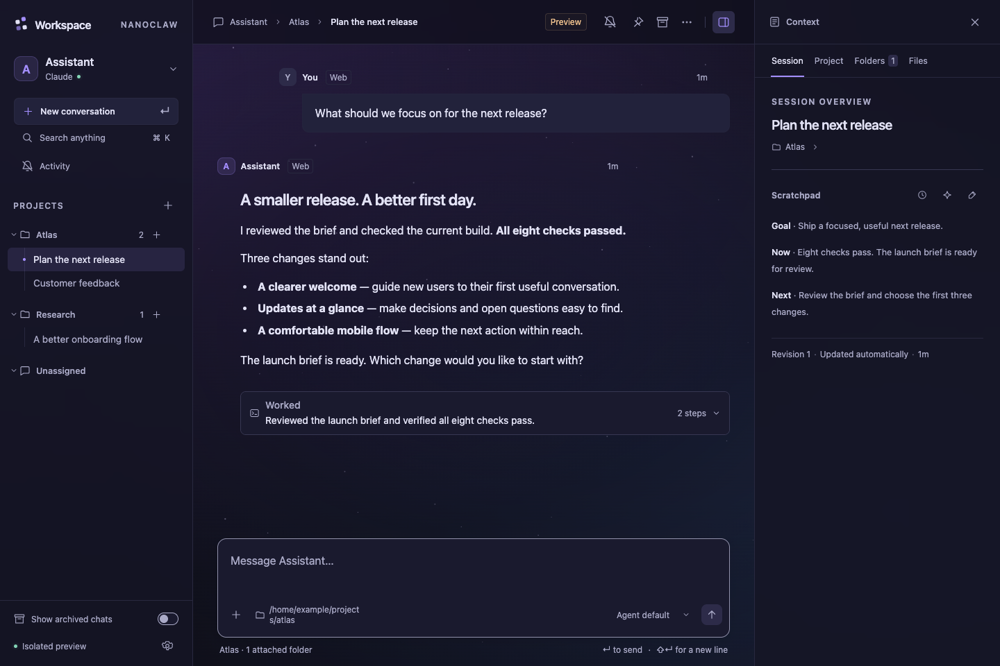
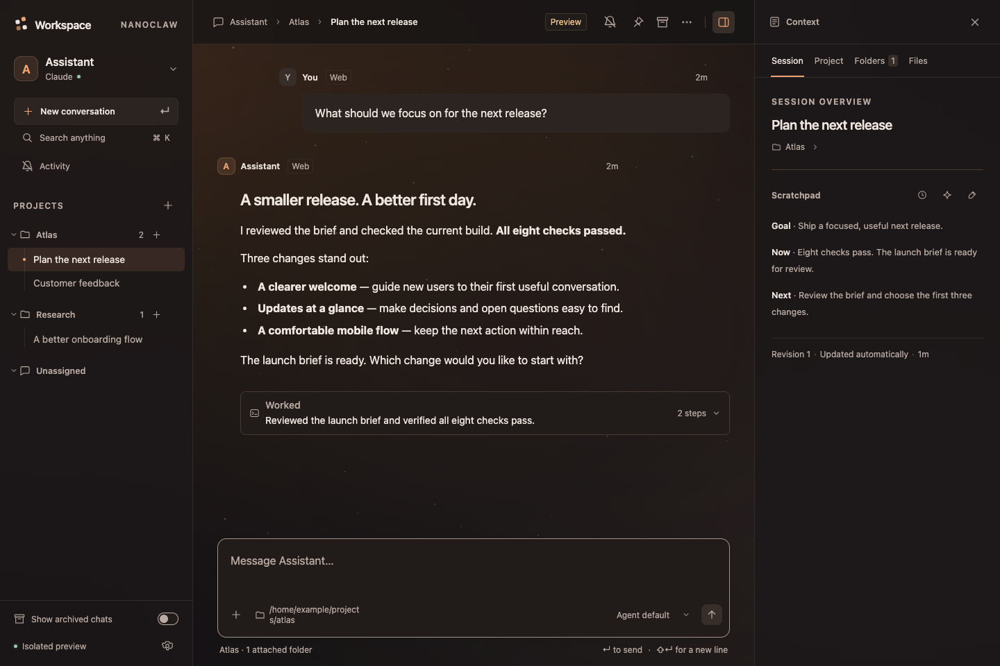
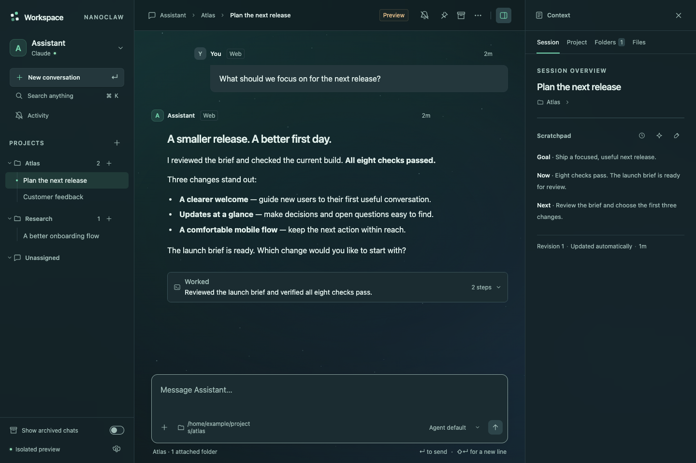
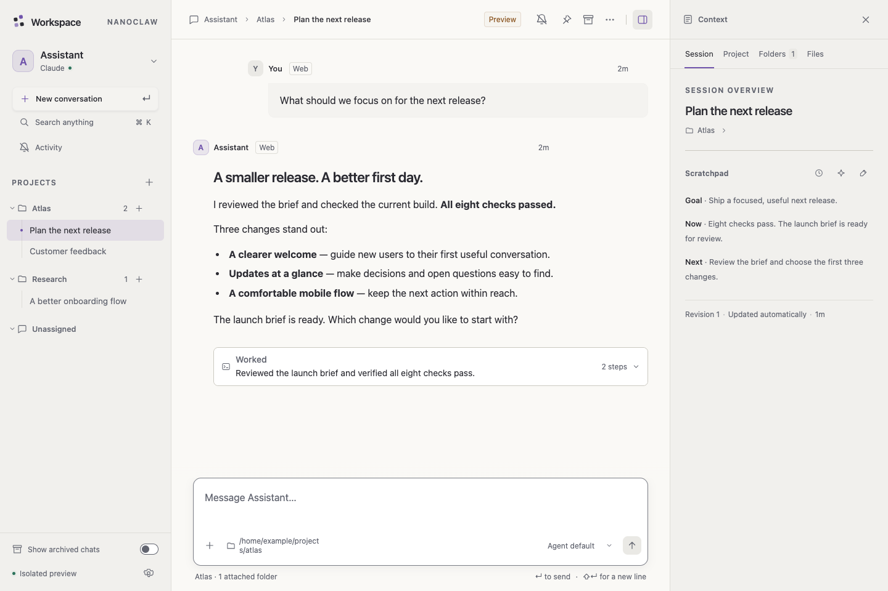

# NanoClaw Workspace UI

**A home for your agents. A workspace for your projects.**

[](https://github.com/NmadeleiDev/nanoclaw-workspace-ui/actions/workflows/ci.yml)
[](LICENSE)

Turn NanoClaw into a daily workspace: projects with shared context, conversations with their own working folders, living scratchpads, file previews, and a clear view of what your agents did. Work on your Mac, then pick it up on your iPhone over your private tailnet.


[Get started](#get-started) · [File previews](#review-files-with-your-agent) · [Themes](#make-it-yours) · [Demo tour](docs/demo.md) · [Installation](docs/installation.md) · [User guide](docs/workspace-ui.md) · [Changelog](CHANGELOG.md)

## Built around the work

**Agent → project → conversation.** A project holds the brief, default folders and shared notes. Each conversation inherits that context and can choose its own folders and model. Your agent knows what the project is and where it is working.

| Feature | What it does |
| --- | --- |
| **Projects with context** | Give each project a name, brief, working folders and a shared scratchpad. |
| **Conversations with memory** | Keep revisioned session notes, project notes and background overviews. Bounded scratchpad previews expand when you want the whole picture. |
| **An overview worth opening** | Recent conversations come first, with latest-message previews and visible unread indicators. Search across your workspace. |
| **An ordered record of the work** | Follow messages, provider-reported reasoning and tool calls in order. Expand **Working** or **Worked** to inspect inputs, outputs and status. Activity survives completion, approval pauses and errors; optional summaries explain tool outcomes at a glance. |
| **Decisions with a record** | Review pending approvals with deadlines and optional comments, then revisit decisions and application results in **History** for 90 days. **Ask agent again** requests a fresh assessment of a rejected or expired request. |
| **Context at a glance** | See the latest context occupancy below the composer, with token counts on hover and an honest unavailable state when a backend has no reading. |
| **Quote and reply** | Select a passage in an agent reply and choose **Quote**, or quote the whole message. Your existing draft stays intact. **Alt/Option+Q** works too. |
| **File previews beside chat** | Open Markdown, text/code, PDFs and images in a tabbed document drawer. Your agent can open a working file there for review. Edit writable text files and quote passages back into the conversation. |
| **Images and attachments** | Paste images with ⌘V, drop files into chat, or use the attachment picker. Preview and remove attachments before sending, then reopen them from chat or **Files**. Image understanding depends on the model. |
| **Local voice input** | Dictate through a standalone **whisper.cpp** server or the optional **MyWhispr** macOS CLI. Review and edit the transcript before sending. |
| **Agents and API connections** | Edit agent model defaults and API connection metadata in Settings. Model selectors show provider/model names; credentials stay in NanoClaw’s gateway. |
| **Useful names, immediately** | New chats use your first message as a provisional title while utility naming runs. Rename with Enter whenever you like. |
| **Private mobile access** | Localhost by default; optional Tailscale HTTPS, device pairing, installable PWA and scoped notifications. |
| **Bring your history** | Import OpenClaw conversations as read-only reference history, with explicit agent mapping. Continue them in a fresh NanoClaw conversation. |

## Review files with your agent

Ask **“Open the report in the file preview so we can review it together.”** The agent can open a file from its workspace or an accessible mounted folder directly in the conversation’s document drawer. It can also show an attachment, return to an open document, or refresh it after making changes. You can open attachments yourself by clicking them in chat or **Files**.

Keep the conversation and the document side by side:

- **Read in place.** Preview rendered Markdown, text and source code, PDFs, and images. PDFs render locally in your browser. Other formats remain available to download.
- **Keep several files open.** Switch between document tabs; the browser remembers them per conversation. Closing the drawer keeps your tabs, and **Context** returns to your notes and folders.
- **Edit working files.** Edit writable text or Markdown and save with **⌘/Ctrl+S**. Attachments and files in read-only folders stay read-only. Clean previews follow disk changes; unsaved drafts stay intact, and a stale save prompts you to reconcile with the latest file.
- **Quote exactly what you mean.** Select a passage and choose **Quote**, or press **Alt/Option+Q**. The composer keeps it as a removable quote with its source, alongside your reply. The agent receives the file name, path or attachment ID, and revision; PDF quotes include the page. Nothing is sent until you send the message.

Agents use the built-in `workspace_viewer` tool to open, focus, refresh and list documents. Opening a preview requests presentation in that conversation; it does not mean the user has read it. Agents cannot close your tabs or discard your edits. Preview access follows workspace and folder permissions, with hidden files and runtime/credential files excluded.

Text previews support files up to **2 MiB**; PDFs and images support previews up to **20 MiB**. See the [document viewer guide](docs/workspace-ui.md#document-drawer) for editing, conflict recovery and access details.

## Make it yours

Four built-in themes, each with light, dark and system appearance. Optional ambient backgrounds add gentle motion and honor reduced-motion preferences. Prefer a quiet canvas? Choose Classic or switch animation off.

| Cosmic Night | Ember |
| --- | --- |
| Violet clouds and a little room to dream. | Warm copper light and an easy evening feel. |
|  |  |

| Northern Lights | Classic |
| --- | --- |
| Cool slate with a soft aurora. | Familiar, focused and understated. |
|  |  |

System fonts, a **100–200% text-size control**, keyboard focus indicators, responsive layouts and touch-friendly controls make the workspace comfortable across screens. Messages, navigation and notes scale together.

## Small models, useful jobs

Utility models handle the housekeeping around a conversation:

- **Titles:** turn a first-message placeholder into a useful conversation name.
- **Session overviews:** concise status cards focused on the goal, current state and supported next action or blocker, following the conversation’s language.
- **Project scratchpads:** keep a shared overview across conversations, with revision history and human edits.
- **Tool activity summaries:** a short sentence describing observed actions, results or blockers; expand the block to inspect the original record.

Choose **Ollama**, **Apple on-device inference** on a supported Mac, or a **configured NanoClaw agent** in Settings → Utility models. Set a shared default or override individual jobs. Agent utilities run in isolated sessions with tools disabled. Automatic summaries can be switched off; older tool blocks can be summarized on demand.

Speech is configured separately in Settings → Speech. The standalone whisper.cpp backend works without MyWhispr. Models and speech servers are not installed or downloaded by this add-on.

## Your workspace, on your phone

Enable private access in **Settings → Access**, create a device link, and open it on an iPhone connected to Tailscale. Add the site to your Home Screen, open the installed app, and enable notifications there.

Notification controls cover **global, device, agent, project and conversation** scopes. Global and device gates always apply; more specific conversation/project choices override inherited preferences. Choose how much a notification preview reveals, mute individual conversations, and manage paired devices from Settings. Notifications start disabled.

The Mac or workspace host must stay available for chats and notifications. The PWA caches the app shell, not your conversations or attachments; offline launch offers connection recovery rather than offline agent execution.

## Get started

This is an **early source add-on for NanoClaw v2**, supporting its Docker runtime. It integrates with an existing configured checkout. The tested upstream revision is pinned in [compatibility.json](compatibility.json); other revisions need validation.

```sh
git clone https://github.com/NmadeleiDev/nanoclaw-workspace-ui.git
cd nanoclaw-workspace-ui
node install.mjs --target /path/to/nanoclaw --check
```

Follow the [installation guide](docs/installation.md) to stop the target host, apply the add-on, build, and pair with your existing owner account. Preflight refuses conflicting source edits; the installer does not restart services. You need Node 22.18+, pnpm, Docker and a configured NanoClaw credential gateway. Runner validation also uses Bun.

Once installed:

```sh
ncl workspace enable
ncl workspace open
```

Create a project, attach a folder, and start a conversation. Everything else—appearance, utility inference, speech, agent defaults, mobile access and notifications—is in Settings.

## Inspectable by design

The UI reuses NanoClaw’s agents, routing, session mailboxes and credential gateway. Its module owns project metadata, scratchpads, access and notification preferences. The [source manifest](manifest.json) and [integration patch](integration.patch) make that integration inspectable.

This repository ships public source and fictional demo content. It contains no personal workspace, credentials, session databases, imported conversations or native agent execution backend. The optional Apple helper performs utility inference only.

Release archives use an explicit allowlist, SHA-256 checksums and normalized metadata. Installation and [removal](REMOVE.md) protect edited source and preserve user data. See [verification](docs/verification.md) for observed coverage and limitations.

## Contribute

```sh
node release.mjs --check
WORKSPACE_UI_UPSTREAM=/path/to/nanoclaw node --test tests/*.test.mjs
node release.mjs --build
```

The test checkout must contain the pinned upstream commit and installed dependencies. CI reconstructs a clean upstream checkout and exercises installation, host/frontend builds and regression tests on Linux and macOS. See [CONTRIBUTING.md](CONTRIBUTING.md) for the full workflow, or [open an issue](https://github.com/NmadeleiDev/nanoclaw-workspace-ui/issues) with a reproducible bug or a focused feature proposal.

MIT licensed. Built on [NanoClaw](https://github.com/nanocoai/nanoclaw); an independent community add-on. Third-party credits are in [THIRD_PARTY_NOTICES.md](THIRD_PARTY_NOTICES.md).
